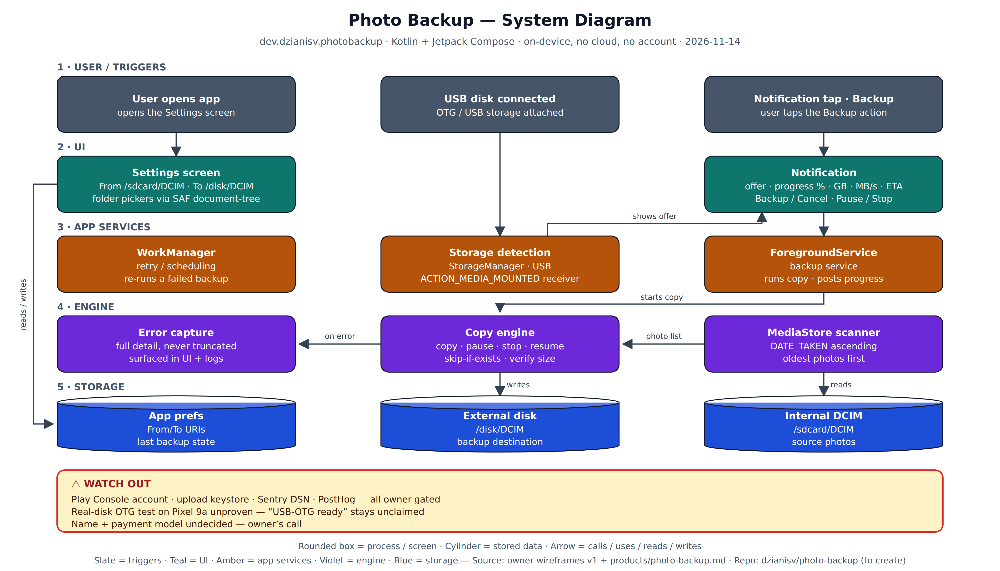

# SnapDisk

Back up photos and videos oldest-first from internal storage to an
external disk, in the background — no cloud, no upload, no account.

- Disk connected → notification offers Backup ("External storage is
  connected. Backup photos?" [Backup] [Cancel]); Pro auto-starts
  the backup on connect
- Tap Backup → the copy runs as a foreground service; the notification
  shows a progress bar + "25%, 25GB/100GB, 125MB/s, ETA 34m." with
  [Pause] [Stop]
- Copy order: oldest photos first, internal → external, mirroring
  the source folder tree (Camera, Screenshots, …)
- App opened → settings screen only: From folder (default
  `/sdcard/DCIM`, folder picker) and To folder (default `/disk/DCIM`,
  folder picker), via the Storage Access Framework document-tree picker
- Copy with skip-if-exists + resume of partial `.part` files + size
  verification after every file; one bad file is retried once, then
  skipped with its reason — it never stalls the job; files ≥4 GB on
  FAT32 are skipped with their reason
- A disk removed mid-copy pauses the backup with the full error,
  resumable when the disk is back; resuming on a different disk is
  refused
- Errors show the FULL error with Copy — never one truncated line
- Free: manual backup, 5 GB per run. Pro ($9.99 one-time): auto-backup
  on connect + unlimited backup size

Native Android, Kotlin + Jetpack Compose, Material 3, standard
components only.

## System diagram



[System diagram (SVG)](docs/system-diagram/photo-backup-system-diagram.svg) —
regenerate with [docs/system-diagram/generate_diagram.py](docs/system-diagram/generate_diagram.py).

## Build

```sh
gradle assembleDebug          # debug APK
gradle testDebugUnitTest       # unit tests
gradle assembleDebugAndroidTest  # compile instrumented tests
gradle connectedDebugAndroidTest # instrumented tests (needs an emulator)
```

CI (three workflows, same pattern as
[Convert264](https://github.com/dzianisv/h264-converter)):

- **Android PR** — unit tests + instrumented-test compile + debug APK
- **Android Release** (tag `v*`) — unit tests + release APK + AAB +
  merged-manifest audit (package, versionName == tag, permissions) +
  foreground-service/receiver audit + dex-not-obfuscated check
- **Emulator Smoke Test** (tag `v*` + manual) — instrumented tests on
  a Pixel 7 / API 35 emulator; evidence in `tool/smoke-screenshots/`

## Status — v0.1.0

Pre-launch (Stage 0). First MVP: settings screen, mount detection,
offer + progress notifications, foreground-service copy, pause/resume/
stop, oldest-first, resume + size verification, skip-and-continue,
Pro billing wired ($9.99 one-time `pro_unlock`).

Blocked on the owner (not shippable to Play yet):

- Play Console developer account ($25) + stable upload keystore
  (CI signs with a throwaway keystore — a future properly-signed build
  needs a reinstall, not an update). **This is the one remaining gate
  for Play publish — everything else is prepared in
  `tool/play-store/`.**
- Sentry DSN
- PostHog project (no key — not installed, never hard-coded)
- Real-device proof: USB disk / OTG on his Pixel 9a (emulator-only
  verification so far; "USB-OTG ready" is NOT claimed in the UI)
- A real sandbox purchase of Pro needs the Play Console app + the
  `pro_unlock` product to exist; billing is wired and degrades
  gracefully without Play, but the purchase itself is unverified
  until then

## Privacy

See [PRIVACY.md](PRIVACY.md): the app collects nothing, has no
analytics or ads SDKs, and never uploads photos. The Pro purchase is
handled entirely by Google Play Billing.
